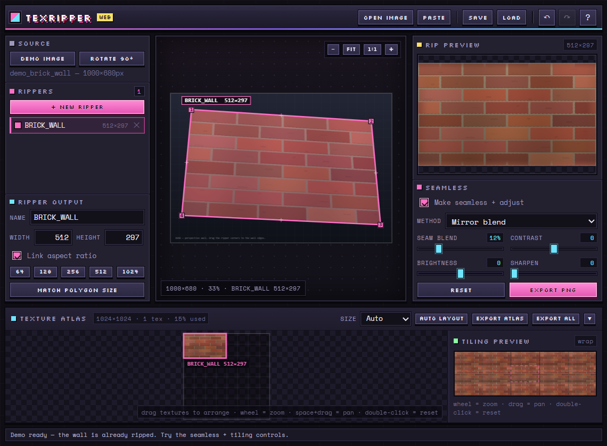

<div align="center">

# TexRipper

**Rip it. Straighten it. Make it tile. Pack it.**

A retro-styled browser tool that pulls perspective-corrected textures out of any photo,
makes them seamlessly tileable, and packs the results into a texture atlas.

[](#)
[](#)
[](#)
[](#license)



</div>

> **Try it in 5 seconds:** open `index.html`, click **Demo Image**, and drag the pink handles.
> The whole tool is one static page — no install, no server, no build.

---

## Why

Photos are full of great textures, but they're never flat, square, or tileable. TexRipper fixes
that in a tiny, dependency-free page:

1. **Pick a surface** with a polygon ripper.
2. **Undo the perspective** and get a clean rectangular texture.
3. **Make it tile** with live seam blending.
4. **Pack it** into an atlas and export a PNG.

Built for game jams, texture studies, photobashing, pixel-art workflows, and anyone who needs a
texture in five minutes instead of an image editor adventure.

## Features

- **Perspective ripping** — 4-point rippers solve a true homography, so angled walls become flat
  textures instead of skewed crops.
- **General polygon rippers** — `Alt`+click an edge to add points (5+). A boundary-matched triangle
  mesh warps irregular shapes into the full rectangle.
- **Live output preview** — every ripper has its own resolution and preview.
- **Seamless generation** — two methods with a live tiling preview.
- **Seam & tone controls** — seam blend width, contrast, brightness, and unsharp-mask sharpening.
- **Texture atlas** — automatic shelf packing at 512 / 1024 / 2048 / 4096 (or Auto), with
  drag-to-arrange entries and a used-space readout.
- **Exports** — selected texture, all textures, or the entire atlas as PNG.
- **Projects** — save/load JSON with the source image embedded, plus undo/redo.
- **Comfortable canvas** — pan/zoom, fit/1:1, axis-locked dragging, pixel snapping, and 90° rotation.
- **Retro UI** — chunky pixel panels, keyboard-first, no telemetry, no accounts, no uploads.

## Quick start

**Option A — double-click `index.html`.** That's it; the whole app is a static page.

**Option B — serve the folder** (handy if your browser is strict about `file://`):

```bash
python -m http.server 8000
# → http://localhost:8000
```

Click **Demo Image** to load a generated perspective wall with a ripper already placed on it.

There is nothing to install or compile.

## How to use

1. **Load an image** — *Open Image*, drag & drop anywhere, or paste with `Ctrl+V`.
2. **Shape the ripper** — drag the four corner handles onto a flat surface. `Alt`+click an edge
   midpoint to add a vertex; right-click a vertex to remove one.
3. **Set the resolution** — type a width/height, pick a preset, or hit **Match Polygon Size** to fit
   the ripper's bounds (capped at 512 px; type a larger size for more detail).
4. **Make it seamless** — choose a method, dial in the seam blend, and adjust contrast/brightness/
   sharpen while watching the tiling preview. Scroll it to zoom, drag to pan.
5. **Build the atlas** — new textures are packed automatically. Drag them around, hit **Auto Layout**
   to repack, then **Export Atlas** or **Export All**.

## Seamless methods

| Method | How it works | Best for |
| --- | --- | --- |
| **Mirror blend** | Cross-fades each edge band with a mirrored copy, making opposite edges identical. | A guaranteed perfect wrap on most textures. |
| **Offset feather** | Rolls the image by half a tile, then feathers the shifted copy over the borders. | Photographic textures with continuous detail. |
| **None** | Leaves the raw rectified rip untouched. | When you'll finish the tiling elsewhere. |

A wider **Seam Blend** hides more mismatch but can introduce ghosting. Start around 10–15% and
raise it only if the tile boundary is still visible.

## Keyboard shortcuts

| Shortcut | Action |
| --- | --- |
| `Ctrl`+`O` | Open image |
| `Ctrl`+`V` | Paste image from clipboard |
| `Ctrl`+`S` | Save project |
| `Ctrl`+`E` | Export selected texture |
| `N` | New ripper |
| `F` | Fit image to viewport |
| `Ctrl`+`D` | Duplicate ripper |
| `Delete` | Delete selected ripper |
| `Ctrl`+`Z` / `Ctrl`+`Shift`+`Z` | Undo / redo |
| `Shift`+drag | Lock a point or ripper to one axis |
| `Ctrl`+drag | Snap to whole pixels |
| `Alt`+click edge | Insert a point |
| Right-click point | Remove a point (on 5+ point rippers) |
| `Space`+drag / middle-drag | Pan |
| Mouse wheel | Zoom |
| `?` | Open help |
| Double-click viewport | Fit image |
| Double-click atlas / tiling | Reset that view |

## How it works

- **4-point ripper** — solves the eight-parameter homography mapping the output rectangle to the
  source quad, then inverse-maps every output pixel and samples bilinearly. That's what straightens
  the perspective.
- **5+ point ripper** — parameterises the polygon and the output rectangle by arc length, inserts
  the rectangle corners as boundary vertices, and affine-maps matching triangle fans. The rectangle
  is always fully covered, corners included.
- **Mirror blend** — blends each border band toward a horizontally/vertically mirrored copy; at the
  edges the mirrored pixel is the opposite edge pixel, so the wrap is mathematically continuous.
- **Offset feather** — rolls the image by half a tile and feathers the shifted copy over the outer
  border, so the border shows continuous content from the middle of the source.
- **Atlas** — height-sorted shelf packing with 2 px padding; each texture stores its own atlas
  position so you can rearrange it by hand.

Everything is plain JavaScript and Canvas 2D. No frameworks, no WASM, no build tools. The only
network request is the optional Google Fonts stylesheet; offline, the UI falls back to system
monospace and works exactly the same.

## Project layout

```
.
├── index.html            UI shell + panels
├── css/
│   └── style.css         retro pixel theme, layout, responsive rules
├── js/
│   ├── geometry.js       homography, polygon warp, bilinear sampling
│   ├── seamless.js       seamless methods + tone/sharpen
│   └── app.js            state, rendering, input, atlas, save/load, demo
├── docs/
│   └── screenshot.png
├── LICENSE
└── README.md
```

## Deploy to GitHub Pages

This is a static site, so Pages can host it as-is:

1. Push this folder to a GitHub repository (e.g. `texripper`).
2. **Settings → Pages → Build and deployment**.
3. Source: **Deploy from a branch** → branch `main` → folder **/ (root)** → **Save**.
4. Open `https://<your-username>.github.io/texripper/` in a minute or two.

No workflow, secrets, or build step required.

## Browser support

Recent Chrome/Edge, Firefox, and Safari. Requires Canvas 2D, Pointer Events, `ImageData`, and
`canvas.toBlob`. A desktop browser with a mouse is recommended; touch works for the basics but
pinch-zoom isn't implemented yet.

## Limitations

- Seamless quality depends on the photo. Strong lighting, gradients, or unique details will ghost
  where the borders are blended.
- 5+ point rippers use a piecewise-affine mesh rather than a single homography; extra vertices are
  best for small shape corrections along the edges.
- Textures are capped at 2048×2048 and source images at 4096 px on the longest side.
  Outputs above ~700k pixels recompute on mouse release instead of live.
- Atlas packing is a simple shelf algorithm — it won't find the mathematically tightest layout.
- Rotating the source image is not part of the undo history.
- Browsers may block *Export All* if automatic downloads are disabled; allow downloads for the page.

## Roadmap ideas

- [ ] Curved / multi-segment ripper edges
- [ ] PBR map generation (normal, roughness, height)
- [ ] Per-texture atlas scaling and rotation
- [ ] Pinch-zoom and touch-friendly handles
- [ ] Batch import of multiple source images

## Credits

The concept is inspired by **[Puck's Texture Ripper](https://puszke.itch.io/pucks-texture-ripper)**.
This is an independent, unaffiliated web reimplementation — no original code, assets, or branding
are used.

UI, code, and demo artwork were made for this project.

## License

[MIT](LICENSE) © 2026 TexRipper contributors

---

<div align="center">
<sub>Built with vanilla JS, Canvas 2D, and an unreasonable love of chunky borders.</sub>
</div>
